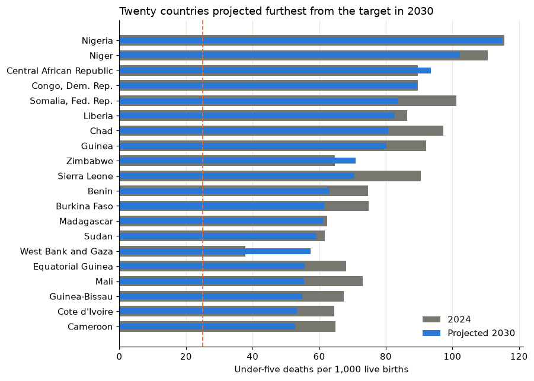

# Child survival and the 2030 target

Which countries will miss the SDG target for under-five mortality, how far off they are, and what separates countries that do better than their income predicts.

**[Open the live dashboard](https://chiamaka-uchenna.github.io/child-mortality-sdg/)** · **[Read the notebook](notebooks/child_mortality_sdg.ipynb)**



## The problem

Almost five million children still die each year before their fifth birthday, mostly from preventable causes. Sustainable Development Goal 3.2 commits every country to an under-five mortality rate of 25 or fewer per 1,000 live births by 2030. Knowing who is off track and by how much helps direct attention and money.

## Data

[World Development Indicators](https://databank.worldbank.org/source/world-development-indicators) (World Bank, CC BY 4.0), downloaded through the public API. Sixteen indicators for 196 countries from 2000 to 2024. Mortality estimates are from the UN Inter-agency Group for Child Mortality Estimation.

The notebook downloads the data itself the first time it runs and caches it in `data/raw/`, so nothing needs to be downloaded by hand.

## Key results

- The world under-five mortality rate fell from 77 to 37 per 1,000 between 2000 and 2024, and annual deaths from 10.1 million to 4.9 million.
- On current trends 61 countries will miss the 2030 target, 44 of them in Sub-Saharan Africa. The typical off-track country is reducing mortality by 2.6% a year and would need about 11% a year.
- Ten countries account for 60% of all under-five deaths. Nigeria has the largest number and almost no measured improvement over the last decade.
- A model with 13 development indicators explains 89% of the variation in mortality across countries it has never seen, against 72% for income alone. Sanitation and fertility carry the most weight after income.
- Comparing each country with its out-of-sample prediction identifies countries doing markedly better or worse than their circumstances suggest.

## Approach

1. Assembling a country-year panel from the World Bank API and separating countries from aggregates
2. Annual rate of reduction and log-linear projection to 2030, as used by UNICEF
3. Grouped cross-validation that holds out whole countries
4. XGBoost with monotonic constraints that encode public health knowledge
5. SHAP importance, partial dependence, and out-of-sample residual analysis

Every step is explained in the notebook, with the reasoning behind each decision.

## Live dashboard

The dashboard is a static page served by GitHub Pages from the `docs/` folder. The trained model is exported from the notebook as JSON and scored in the browser with a few lines of JavaScript, so there is no server to maintain. The notebook checks that the exported model reproduces the original predictions before writing the file.

## Repository layout

```
notebooks/child_mortality_sdg.ipynb   the full analysis, with outputs
docs/                       the live dashboard (HTML, CSS, JavaScript and exported data)
data/                       raw data is downloaded here by the notebook (not committed)
requirements.txt            Python dependencies
```

## Run it yourself

```bash
git clone https://github.com/Chiamaka-Uchenna/child-mortality-sdg.git
cd child-mortality-sdg
python -m venv .venv
source .venv/bin/activate        # on Windows: .venv\Scripts\activate
pip install -r requirements.txt
jupyter notebook notebooks/child_mortality_sdg.ipynb
```

Running the notebook from top to bottom regenerates every figure and rewrites the files in `docs/data/` that the dashboard reads. To view the dashboard locally:

```bash
python -m http.server 8000 --directory docs
```

## Limitations

The model describes associations across countries, not the causal effect of a policy. Mortality figures for countries without complete vital registration are themselves modelled, and national averages hide inequality within countries.

## Author

Chiamaka Uchenna

Code is released under the MIT licence. The data belongs to its publishers and is used under the licences noted above.
